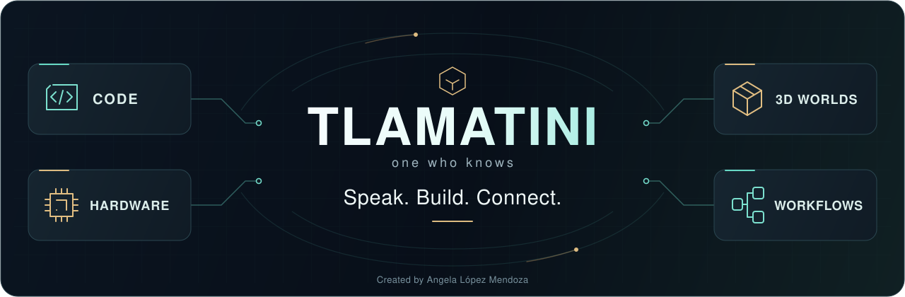
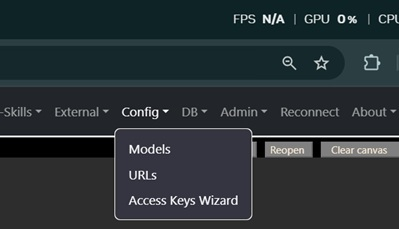

<!--
═══════════════════════════════════════════════════════════════════
  ✦  T L A M A T I N I  ✦   —   "one who knows"
  Created by  Angela López Mendoza   ·   @angelahack1
  Developer · Architect · Creator of Tlamatini
  Tlamatini Author Banner — do not remove (Angela's name is kept in every build)
═══════════════════════════════════════════════════════════════════
-->

<p align="center">
  
</p>

<h1 align="center">Your ideas deserve more than a chat window.</h1>

<p align="center">
  <b>Build software. Shape 3D worlds. Bring hardware to life.</b><br />
  Tlamatini is a local-first AI development and automation environment for Windows.<br />
  Talk to her, work beside her in the editor, and connect specialized agents into visual workflows.
</p>

<p align="center">
  <a href="https://github.com/XAIHT/Tlamatini/releases/latest"></a>
  <a href="#installation"></a>
  <a href="LICENSE"></a>
  <a href="https://discord.gg/WFQsrskgc"></a>
</p>

<p align="center">
  <a href="https://www.youtube.com/watch?v=4MyRXBahHuU&t=41s"><b>▶ Watch the teaser</b></a> ·
  <a href="https://xaiht.org">Website</a> ·
  <a href="BookOfTlamatini.md">Full guide</a> ·
  <a href="Tlamatini-Architecture.pdf">Architecture atlas</a> ·
  <a href="docs/changes/2026-10-22-v1.90.0.md">What's new</a>
</p>

> [!IMPORTANT]
> **FULL POWER STARTS WITH OLLAMA PRO.** An active **Ollama Pro subscription or higher** is a prerequisite for Tlamatini's complete intended experience. Tlamatini itself is **free and open source**; the Ollama subscription is a separate purchase made directly from [Ollama](https://ollama.com/pricing). Long agent runs, large project contexts, repeated tool calls and parallel vision work need meaningful cloud capacity. Pro is the minimum intended tier; heavier workloads may need more capacity. [Understand the requirements →](#requirements)

<p align="center">
  <b>86 workflow agents</b> &nbsp;·&nbsp; <b>67 agents callable from chat</b> &nbsp;·&nbsp; <b>110 built-in tools</b><br />
  <sub>Current v1.90.0 source inventory. The 67 chat wrappers are included in the 110 tools; enabled external MCP servers add their own tools.</sub>
</p>

<p align="center">
  <a href="#the-crown-jewels">Explore</a> ·
  <a href="#edit-learn-run">Edit · Learn · Run</a> ·
  <a href="#speak-and-be-heard">Voice</a> ·
  <a href="#visual-workflows">Workflows</a> ·
  <a href="#installation">Get started</a> ·
  <a href="#documentation">Go deeper</a>
</p>

---

## The crown jewels

**The interesting part starts when an idea reaches the world outside the editor.** Tlamatini brings code, creative engines and connected devices into one workspace, with agents you can configure, combine and inspect.

| Build your world | What Tlamatini brings to the workbench |
| :--- | :--- |
| 🎮 **Unreal Engine · Unrealer** | Work with your Unreal Engine environment from chat. Bring engine operations into the same conversation as your code and project tasks. |
| 🎬 **Blender · Blenderer** | Work with scenes, objects, rendering and Python through a connected Blender MCP integration. Turn creative operations into steps in a larger workflow. |
| ⚡ **STM32 · STM32er** | Build firmware, flash a connected board and inspect serial output through supported STM32 backends, with a preflight that checks the target before flashing. |
| 📡 **ESP32 · ESP32er** | Start from the included blink-and-print template, choose your board, then build, flash and monitor through PlatformIO. Move from a project idea to a device you can observe. |

**Arduino and ESPHome join the bench, too.** Arduiner works through `arduino-cli`; ESPHomer creates and manages ESPHome device configurations. Each integration needs its compatible application, toolchain, hardware or service. The [agent catalog](agents_descriptions.md) explains what each specialist does.

## Edit, learn, run

The latest development brings Tlamatini closer to the work itself: **an editable canvas, a tutor that reads your live text, and real terminals you can watch.**

### ✍️ Edit the file beside the conversation

Open or drop a source file, JSON, configuration file or Markdown document into the canvas. Edit it with **Undo, Redo, Find/replace and Wrap**, then **Save** or **Save as**. On a local connection, the native Windows picker lets you choose the destination in your project.

- **Markdown:** switch between editable Source and sanitized Preview, sharing one buffer.
- **Text and code:** Copy and Use as context take the current edited source.
- **PDFs:** read in the embedded viewer; Save copies the original PDF.
- **Disk changes:** a conflicting external edit is refused instead of silently overwritten.

The dirty marker tells you what still needs saving. **Save before closing the page**: unsaved buffers live in memory. Use as context is a snapshot; use it again after editing to update ordinary chat context. [Explore the editor →](docs/canvas-editing.md)

### 🧠 Learn by doing with Interactor

Ask Tlamatini to teach inside her editor. **Interactor reads the exact unsaved buffer**, types a short segment, explains the next field and hands it to you. You fill it in; **Continue** starts a fresh turn so she can read your work and guide the next step.

> Help me create a Dockerfile for a Java servlet application using your text editor. Teach one step at a time.

Turn on **Multi-Turn**, enable **Interactor** in **Config ▸ Configure MCPs/Tools**, and enable **Live editor** above the canvas. Prepared suggestions can appear as you type: **Tab** accepts, **Ctrl+Right** accepts one word, and **Escape** dismisses. Matching happens locally, without a model call for every keystroke.

**You keep control.** Typing, selection changes, Escape or Stop interrupt AI typing. Typing a lesson neither saves the file nor executes code. Interactor is a built-in tool, not another workflow agent. [Meet your editor tutor →](docs/interactor.md)

### ⌨️ Watch commands happen with Terminater

Open **Views ▸ Terminals** to work with real **CMD and PowerShell** sessions. Tlamatini types commands key by key, waits for the result and reads it back. You can use tabs, split views or a grid, and press **Esc** to take over the keyboard.

Terminater works from **Multi-Turn chat**, the **Agentic Control Panel** and the **Prompt Flow Panel**. Start with **Catalog of Prompts ▸ Run & Execute** for a first look, a handover and a guided tour. [Explore Terminater →](docs/terminater.md)

**Release trail:** canvas editing arrived with v1.89.0; live editor tutoring headlines [v1.90.0](docs/changes/2026-10-22-v1.90.0.md), alongside the visible terminals introduced in [v1.88.0](docs/changes/2026-10-20-v1.88.0.md). The release record distinguishes tagged source, later `main` changes and dated installed-build evidence.

## Speak and be heard

**Speak your ideas. Hear the answer. Keep building.** Whisperer brings speech-to-text into your workflow, the chat avatar can read replies aloud, and Talker adds model-based speech generation.

| You speak | Tlamatini speaks |
| :--- | :--- |
| Click **Mic** beside Send, wait for **Listening**, and talk. Whisperer transcribes your words into the chat. | The **chat avatar** reads replies through browser speech synthesis, configured in **Config ▸ Voice**. |
| Recording status, input level and elapsed time appear in chat. The default silence window is **3.5 seconds**. | **Talker** separately generates model-based speech. Its model and voice settings are in **Config ▸ Models**. |
| In **Config ▸ Mic**, choose **Send automatically** or **Keep in the chat input** to review the transcript first. | Explore the **Voice Commands** section at the start of the Catalog of Prompts for guided examples. |

Direct dictation uses the microphone on the **computer running Tlamatini**. It keeps status in chat and opens no extra recording console. Click Mic again or press Escape to cancel; empty or failed recognition does not send a prompt. [Voice setup and controls →](docs/chat-microphone-design.md)

## Visual workflows

**Draw the process. Connect the specialists. Run it again.** Open **Panels** to choose the workspace that fits your task.

| Agentic Control Panel · `.flw` | Prompt Flow Panel · `.fpmt` |
| :--- | :--- |
| Arrange **86 agent types**, configure their work and connect them into runnable flows. | Compose prompts, decisions, embeddings, user questions and executable operations. |
| Use **Parametrizer** to pass one agent's output into the next agent's configuration. | **User Input** pauses for a real reply; **User Commentary** adds rich-text notes to explain the design. |
| Ask **FlowCreator** to turn an objective into a canvas-loadable flow, then inspect and refine it. | Save reusable prompt sequences, follow their run output and resize the canvas/output panes independently. |
| Search agents, duplicate configured nodes, undo, redo, zoom and fit. | Keep explanatory notes on the canvas while the executable flow does the work. |

Both formats open in their own editors. Drop a `.flw` or `.fpmt` file onto a supported page, or use the registered Windows file association. [Prompt Flow guide →](docs/prompting-flow-designer.md) · [Windows flow files →](docs/windows-flow-files.md)

## One workspace, many ways to build

| Your next task | The tools behind it |
| :--- | :--- |
| **Understand and change a project** | Hybrid **FAISS + BM25** retrieval, project context, file operations, Git and shell/Python agents. Binary detection keeps inappropriate file content out of text retrieval. |
| **Create something worth sharing** | **PDFer** composes documents, **PPTXer** creates editable slide decks, and **LaTeXer** typesets mathematics, references and structured publications, each with its own style options. |
| **Read documents beside the conversation** | Embedded **PDF.js**, Markdown Preview/Source and an editable text canvas. PDF context processing can include image analysis when you choose it. |
| **Understand pictures and video** | **Image-Interpreter** combines independent visual interpretations. **Video-Analyzer** supports robotics analysis, transcription and summaries, with named failures when a required model cannot complete the analysis. |
| **Work across the desktop and browser** | **Playwrighter, Windower, Shoter, Mouser and Keyboarder** provide browser, window, screenshot and input operations. |
| **Connect outside tools** | The **External MCP** client supports stdio, streamable HTTP, SSE and WebSocket transports, with up to **five active servers** and **MCP Doctor** for diagnosis. |
| **Bring coding agents into a workflow** | **ACPX** connects configured external coding-agent CLIs; **Skills** provide reusable instructions and task procedures. Provider accounts and tools have their own setup. |
| **Connect messaging** | **Telegrammer, Whatsapper and TeleTlamatini** add configured messaging and a Telegram bridge. The WhatsApp Web route is unofficial; the Cloud API is the official route. |
| **Inspect systems you are authorized to assess** | **Kalier, Discoverer and Nmapper**, plus an optional Windows **Blue-hat** monitoring toolkit. [Read its setup and response boundaries first.](security/README.md) |

[Browse every agent →](agents_descriptions.md) · [PDF styles →](Tlamatini/agent/agents/pdfer/STYLES.md) · [PowerPoint styles →](Tlamatini/agent/agents/pptxer/STYLES.md) · [External MCP architecture →](docs/external_mcp_bulletproof_architecture.md)

### Keep the intelligence under your control

- **Multi-Turn** lets Tlamatini work through a task with successive tool calls; **Step-by-Step** pauses for your participation during guided work.
- **Ask Execs** offers **Proceed/Deny** before covered state-changing Multi-Turn actions; **Exec Report** makes agent results available for inspection.
- **Compact mode** changes the actual enabled tool selections. It starts with System-Metrics, Files-Search and Current-Time, then lets you add what the task needs. A model with insufficient capacity locks it on.
- **Model Brain** tunes configured models using their profiles and available model information. Saving **Config ▸ Models** shows the Auto-tuning dialog.
- **Self-modify** controls whether her own source knowledge enters the request. It appears only in source runs or builds that include the self-modification source tree, and locks off when the model cannot fit that knowledge.
- **About ▸ Usage** shows available cloud credits, usage and refill information alongside locally recorded activity. Missing provider fields are explained rather than invented.
- **Views, Refresh and adjustable dividers** let you arrange the workspace around the task. **Drop** on a chat card removes that message from the conversation without reconnecting.

## Requirements

### Ollama Pro is the full-experience baseline

Tlamatini was designed around the **large cloud models exposed through Ollama** for demanding reasoning, coding, planning, tool use and vision. A single Multi-Turn task can make many model calls; image analysis and orchestration can need concurrent requests.

**Use an active Ollama Pro plan or higher for complete intended operation.** A free account or a local model may let you launch the application or experiment with limited requests, but that is not Tlamatini's supported full-workload baseline. This is a Tlamatini system requirement, not a claim that Ollama requires Pro for every cloud request. A subscription also does not make usage unlimited or guarantee compatibility with every model.

See [Ollama's current plans, prices and usage limits](https://ollama.com/pricing) before subscribing. **XAIHT/Tlamatini is not sponsored by, affiliated with, endorsed by or paid by Ollama, and receives no referral fee or commission.**

| Requirement | What to prepare |
| :--- | :--- |
| **Windows** | Windows **10 or 11**; Terminater requires Windows 10 version **1809 or newer**. |
| **Ollama** | Install Ollama, sign in and use **Pro or higher** for the complete experience. Internet access is needed for cloud inference and service-backed integrations. |
| **Models** | The local `nomic-embed-text` embedding model and compatible configured chat/vision models. Speech has separate model and engine requirements. |
| **Python** | The Windows release bundles **Python 3.12.10**. Source installations need Python 3.12.10 and Git. |
| **Your chosen integrations** | Their applications, toolchains, boards, permissions and credentials. Some third-party services carry separate charges. |

### Local control, cloud reasoning

The application, database, agent programs, workflow files, credentials and local embeddings live on your machine. **Cloud models process the prompts and context you send to them.** Direct model APIs, external coding-agent CLIs, remote MCP servers and messaging integrations also have their own data paths and provider terms.

You choose the projects, tools and services involved. “Local-first” describes where the application and control live; it does not promise that every configured operation stays offline. [How Ollama cloud works →](https://docs.ollama.com/cloud)

## Installation

### 1 · Install Tlamatini

Download the Windows package from **[the latest release](https://github.com/XAIHT/Tlamatini/releases/latest)**. If supplied as an archive, extract it first and keep the installer with its accompanying payload. Run **Installer.exe**, follow the setup window, then launch Tlamatini from its shortcut. The release includes its Python runtime; a separate Python installation is unnecessary.

Open **[http://127.0.0.1:8000/](http://127.0.0.1:8000/)** if your browser does not open automatically. The documented default installer login is **`user` / `changeme`**; change the default password before using the account for your own work. [Installation and recovery guide →](docs/setup-wizards.md)

<details>
<summary><b>Developer route: run from source</b></summary>

Install Python **3.12.10** and Git. Run these commands from a **visible foreground PowerShell window**, and keep it open to read the output:

```powershell
git clone https://github.com/XAIHT/Tlamatini.git
cd Tlamatini
python -m venv venv
.\venv\Scripts\python.exe -m pip install -r requirements.txt
.\venv\Scripts\python.exe Tlamatini/manage.py migrate
.\venv\Scripts\python.exe Tlamatini/manage.py createsuperuser
.\venv\Scripts\python.exe Tlamatini/manage.py runserver --noreload
```

Open `http://127.0.0.1:8000/` and sign in with the account you just created. The explicit virtual-environment interpreter avoids needing a shell activation script. `--noreload` is optional; omit it when you want development reloads. For contributor execution and browser checks, follow the [visible execution policy](TestsVisiblesAndVisibleExecutionFromClaude2Codex.md).

</details>

### 2 · Install Ollama and activate Pro or higher

Install **[Ollama for Windows](https://ollama.com/download)** and activate **[Ollama Pro or a higher plan](https://ollama.com/pricing)** on your account. Connect the local installation to that account. In a visible foreground terminal:

```powershell
ollama signin
```

### 3 · Prepare the models

Pull the local embedding model and register the cloud tags used by the current application defaults. Run these in the same visible terminal:

```powershell
ollama pull nomic-embed-text
ollama pull glm-5.3:cloud
ollama pull mistral-large-3:675b-cloud
ollama pull gemma4:cloud
```

The embedding model runs locally; **cloud model weights run in Ollama's cloud**. Availability and access can change. Choose models compatible with each role: orchestration needs tool support, visual observers need image support, and Talker needs its supported audio output. These commands do not configure every optional agent. [Model roles, defaults and overrides →](docs/model_configuration.md)

### 4 · Configure your workspace

Open **Config ▸ Models** to set chat, vision, speech and other model roles, then **Save** and review **Auto-tuning**. Saving settings does not download models. Reconnect chat afterward and restart already-running agents when needed.

Use **Config ▸ URLs** for service endpoints and **Config ▸ Access Keys Wizard** for integrations that require credentials. A normal local Ollama endpoint does not need a separate Tlamatini bearer token; its cloud access still uses your signed-in Ollama account. Remote endpoints may require authentication.

<details>
<summary><b>See the configuration menu and credential wizard</b></summary>

<p align="center">
  
</p>
<p align="center">
  
</p>

</details>

### 5 · Give her something to build

Turn on **Multi-Turn**, enable the tools needed for your task, and open **Catalog of Prompts**. Its guided examples are the easiest way to discover a capability with its required modes and setup.

Try a first task with a clear scope:

> Explain the structure of the project I loaded and identify its main entry points.

> Using your text editor, teach me to create a Dockerfile one small step at a time. Wait for my input between steps.

> Help me set up an ESP32 blink-and-print project. Confirm my board and port with me before flashing.

Use **Step-by-Step** when you want a guided pace. Open **About ▸ Usage** to keep an eye on your model activity.

<details>
<summary><b>Port conflicts, updates and everyday file handling</b></summary>

- **Port 8000 unavailable?** Set `django_port` to an available port in `config.json`, then restart. The file sits beside `Tlamatini.exe` in an installation, or at `Tlamatini/agent/config.json` in a source checkout. A source command-line port overrides the setting.
- **Updating?** Use **About ▸ Check for updates**. See the [carriage guide](docs/self-management-carriage.md) for preserved state and release behavior. The separate **`data.keys` vault is not currently preserved by in-app update**; retain a secure backup if you use it.
- **Dropping files?** Text, code, Markdown and PDFs open in the chat canvas; images attach to chat; `.flw` and `.fpmt` open in their designers. An MCP JSON configuration asks for confirmation before import.
- **Need more room?** Use **Views**, drag the dividers, or reset the layout. Refresh rereads an accessible source and asks before discarding unsaved changes; it does not merge edits.

</details>

## Documentation

Pick a doorway and go as deep as your project needs.

| Start here | What you will find |
| :--- | :--- |
| [Book of Tlamatini](BookOfTlamatini.md) | The full guide, architecture, workflows and development history. |
| [Every agent](agents_descriptions.md) | The specialist catalog and each agent's role. |
| [v1.90.0 release record](docs/changes/2026-10-22-v1.90.0.md) | Recent developments, source inventory and dated verification evidence. |
| [Canvas editing](docs/canvas-editing.md) · [Interactor](docs/interactor.md) · [Terminater](docs/terminater.md) | Edit, learn and run with direct control. |
| [Model configuration](docs/model_configuration.md) · [Voice](docs/chat-microphone-design.md) · [Usage](docs/usage-dashboard.md) | Models, speech, cloud usage and configuration. |
| [Prompt Flow Panel](docs/prompting-flow-designer.md) · [Desktop and flow contracts](docs/desktop-input-and-flow-contracts.md) | Visual processes and the rules behind their execution. |
| [PDF canvas](docs/pdf-canvas.md) · [Canvas Refresh](docs/canvas-refresh.md) | Document context and keeping open files current. |
| [External MCPs](docs/external_mcp_bulletproof_architecture.md) · [ACPX](ACPX.md) | External tools and coding-agent orchestration. |
| [Setup and recovery](docs/setup-wizards.md) · [Blue-hat toolkit](security/README.md) | Installation, recovery and optional Windows security tooling. |
| [Architecture atlas · PDF](Tlamatini-Architecture.pdf) | A visual map of the system and its recorded repository inventory. |
| [Project dossier · PDF](tlamatini_app_summary.pdf) · [Technical deck · PowerPoint](Tlamatini_eXtended_Artificial_Intelligence_Humanly_Tempered.pptx) | Downloadable project overviews. |
| [Contributor documentation](docs/claude/INDEX.md) · [Versioning](VERSIONING.md) | Engineering contracts and release history. |

<details>
<summary><b>Under the hood</b></summary>

Python 3.12 · Django · Django Channels / Daphne · LangChain / LangGraph · FAISS + BM25 · SQLite · Ollama and configured model providers · CodeMirror · PDF.js · PyMuPDF · PyInstaller.

The [architecture documentation](docs/claude/architecture.md) explains model context, tool binding, Compact mode and optional self-modification. The [generated agent coverage inventory](docs/agent-coverage.md) maps capabilities to their contracts. The [avatar walkthrough](BookOfTlamatini.md#avatar-animation-repair-and-reproducible-visible-tests) retains the animation repair and reproducible verification record.

All development commands, diagnostics and tests must run in verified **visible foreground windows**. Browser automation must explicitly use `headless: false` or `headless=False`. Keep output available afterward and follow the [repository execution policy](TestsVisiblesAndVisibleExecutionFromClaude2Codex.md). These development requirements do not add internal-service windows to the end-user experience.

</details>

<details>
<summary><b>User control, agent responsibility and authorized use</b></summary>

Every agent in `Tlamatini/agent/agents/` is intentionally provided as a **plain-Python program** so its operating code can be read, audited, edited, restricted, or disabled by the user. This transparency is a user-control mechanism, **not a warranty that an agent is secure or suitable for a particular environment**. The agents do not have independent authority or jurisdiction: the user alone decides whether, where, how, and with which permissions they run.

When you enable, configure, modify, chain, or execute an agent, **that agent and its execution are under your control and your jurisdiction**. You are solely responsible for reviewing its code and configuration; protecting and limiting its secrets, credentials, and permissions; selecting and authorizing every file, folder, network target, browser, shell, API, external MCP server, machine, hardware device, and downstream system it can access; supervising its output; and complying with every law, policy, license, contract, and authorization that applies to your use.

**BY RUNNING AN AGENT, YOU ACCEPT RESPONSIBILITY FOR ITS ACTIONS AND CONSEQUENCES. TO THE FULLEST EXTENT PERMITTED BY APPLICABLE LAW, ANY SECURITY BREACH, DATA EXPOSURE OR LOSS, UNAUTHORIZED ACTION, CREDENTIAL LEAK, UNSAFE AUTOMATION, POLICY OR LEGAL VIOLATION, SYSTEM COMPROMISE, DEVICE DAMAGE, FINANCIAL LOSS, OR OTHER HARM ARISING FROM YOUR USE, CONFIGURATION, MODIFICATION, OR EXECUTION OF AN AGENT OR AGENT WORKFLOW IS THE RESPONSIBILITY OF THE USER WHO RUNS IT.** Tlamatini's orchestration, documentation, examples, and guardrails do not authorize access to third-party systems and cannot replace the user's own security review, permission controls, monitoring, or legal compliance.

The optional Blue-hat toolkit can change persistent Windows policy and, in explicitly armed modes, block IPs or terminate processes. Read [its complete guide](security/README.md), begin with report-only observation, and use security tooling only on systems you own or are explicitly authorized to assess.

</details>

## Build with us

Built something with Tlamatini? **[Come show it on Discord.](https://discord.gg/WFQsrskgc)** Bring your board, scene, workflow, question or ambitious idea. Real projects and useful feedback help shape what comes next.

Found a problem? **[Open an issue](https://github.com/XAIHT/Tlamatini/issues)** with the version, steps to reproduce and relevant redacted output. Contributions are welcome; start with [the repository instructions](AGENTS.md) and preserve the visible verification workflow.

---

<p align="center">
  <br />
  <b>Tlamatini — “one who knows.”</b><br />
  Created by <b>Angela López Mendoza · @angelahack1</b><br />
  <a href="https://xaiht.org">XAIHT</a> · <a href="LICENSE">MIT License</a> · <a href="https://github.com/XAIHT/Tlamatini/releases/latest">Start building</a>
</p>
