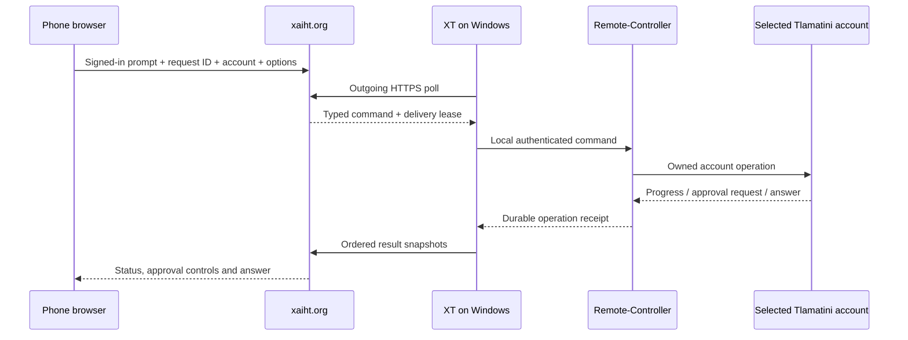

<!-- Tlamatini — Created by Angela López Mendoza · @angelahack1 -->
# Website prompts: account access, approvals and verified behavior

Documentation reviewed on **23 November 2026**, without changing release numbers.
This is a behavior and evidence update, not a new release announcement.

## The complete route



The website connection does not expose the PC's local web server, open an inbound
router port, unlock Windows or start Tlamatini. Start the intended edition normally
and start Remote-Controller from XT. The separate direct RC client has its own
device enrollment and lifecycle permissions; those are not website capabilities.

## Setup and daily use

1. Open Tlamatini and sign in to the intended local user. On **Panels → Tlachihuani ·
   Remote-Controller**, enable that account with its current password.
2. Start **Remote-Controller** in XT. Connect XT to the computer registered on
   **xaiht.org → Tlamatini-RC**. Keep an existing working website connection;
   refreshing a page does not require replacing its computer key.
3. In **XT → Services → xaiht.org → Accounts…**, check the exact ready account
   and save access. Identical names in English/Spanish or older registrations do
   not identify the same account. Select by edition and readiness; do not approve
   every duplicate-looking row merely because its name matches.
4. On the phone select the computer, refresh accounts, then select the intended
   ready account under **Talk to Tlamatini**. Send one prompt and follow its status.
5. Keep XT, Remote-Controller and the selected Tlamatini instance running.
   Reconnect and inspect an existing request before submitting it again.

The website grants chat and monitoring for explicitly approved bindings. Local
and remote conversations cannot overlap model work for the same account. Changing
the selected account changes the request owner, not the model or that account's
permissions. The website does not choose a separate remote model.

## What Ask Execs actually means

**Ask before protected actions** is the corrected source label. An older deployed
page may still say **Ask before executing tools**. Both use the same
`ask_execs_enabled` option; neither means that every tool asks for confirmation.
Multi-Turn must be enabled for this modifier.

The existing Tlamatini policy gates selected command/script runners, destructive
or overwriting operations and selected network operations. **Monitor Netstat and
direct Netstat are read-only exemptions**. Desktop/hardware operations and
messaging also have deliberate policy exceptions. Do not infer permission policy
from the wording of a tool's name or add confirmation to exempt tools as a
translation change. English and Spanish follow the same policy.

For an action that requests permission, review the displayed tool and arguments.
**Proceed** approves that exact pending request. **Deny** refuses it. Approval
display is not evidence that denial was tested. **Cancel prompt** requests
cooperative cancellation; wait for an observed terminal result. Cancellation or
revocation cannot undo actions that have already completed.

## Delivery, answers and privacy

- Diagnostic messages use `xaiht.tlamatini-rc.message/1` and remain inert even
  when their diagnostic type is `command`. Executable requests use the separate
  closed schema `xaiht.tlamatini-rc.command/1`.
- A retry preserves its request ID. Reusing that ID with changed content or options
  is rejected. Refresh retrieves existing requests and answers rather than
  submitting a second prompt. Delivery, acceptance and completion are distinct.
- Long answers can show a preview. **Retrieve complete answer** uses a signed,
  account-bound ticket and checked chunks; missing/expired content is an error.
  The website renders answer text without executing returned HTML.
- The website and XT communicate over authenticated HTTPS. The website handles
  and stores prompt/answer content: **this is not end-to-end or post-quantum
  encryption**. XT excludes prompt/answer bodies from its diagnostic log; this
  does not mean that the website database or Tlamatini chat history contains none.
- Remove the account grant locally to revoke website authority. Disconnecting XT
  interrupts transport; do not assume that already admitted work has stopped.
- The phone interface currently sends text. It does not capture the phone's
  microphone. Voice controls in the separately proxied workspace operate the host.

## Evidence and remaining checks

| Evidence recorded on 23 November | Result and scope |
| --- | --- |
| Real isolated MySQL 8.4.13 | 7/7 transaction tests; test schema removed and server stopped |
| Source integration | 76/76 checks, including one actual model answer per edition; approval/cancel and long-answer cases separately labelled fixtures |
| Existing adapter regressions | English 309; Spanish 311; source checks, not newly built installers |
| Native update | 676 Tray/RCServer files matched manifests; existing identities, configuration and state retained |
| Production browser checks | 30/30 anonymous checks at 390px/320px in English/Spanish; not phone or authenticated-account tests |
| Physical phone, installed English account | Prompt/answer and same-conversation reload confirmed by Angela |
| Actual gated Executer prompt | Angela confirmed the approval request appeared |
| Actual phone denial and cancellation | Not completed before Angela stopped tests; do not report them as passed |

The Netstat prompt reached the installed engine with Ask Execs true and a broker
registered; its exemption explains the absence of a dialog. The corrected website
label passed TypeScript, focused lint, 25 transport/response regressions and a
production asset build. Its separate cloud candidate completed but was **not
promoted**. Current source wording and the last deployed page are different.

A later source review identified a possible tool-alias classification gap. New
executor tests were saved but not run before testing stopped; no runtime fix was
made. Resolve that finding and perform actual denial/no-execution, cancellation,
reconnect and per-account/edition acceptance before certifying a coordinated
release. Do not convert saved test files into passing evidence.

The detailed service record is `docs/verification/2026-11-23-hosted-prompts.md`
in the Tlachihuani repository. This documentation refresh does not restart the
applications, resume functional tests, deploy, commit, tag, push or bump versions.

## Shared PDF and PPTX content

This block preserves the structured chapter without changing generators or runtime code. When regenerating the dossier, load this JSON as a `Chapter` and its `Section` records, then extend the existing `architecture` chapter’s sections after `build_chapters(facts)`. Keeping the original nine chapters preserves the contents-slide layout. Generate PDF and PPTX from the same content; verify tree parity, bounds and every page/slide again. This review preserves 1.97.0. The atlas retains its dated inventory and adds a labelled remote supplement.

<details>
<summary>PDF / PPTX</summary>

```json dossier-chapter
{
  "key": "hosted-prompts",
  "numeral": "RC",
  "title": "Remote conversations through xaiht.org",
  "tagline": "Your local account, one explicit remote route.",
  "accent": "jade",
  "sections": [
    {
      "key": "hosted-route",
      "kicker": "REMOTE-CONTROLLER",
      "title": "From the phone to her local engine",
      "lede": "xaiht.org carries real prompts and answers for a ready, explicitly approved Tlamatini account.",
      "points": [
        [
          "Phone",
          "Sign in, select computer and exact account, then send a prompt with its options."
        ],
        [
          "XT",
          "Polls the website through outgoing HTTPS. No inbound router port is needed."
        ],
        [
          "Remote-Controller",
          "Authorizes the local binding and dispatches into the existing Tlamatini engine."
        ],
        [
          "Answer",
          "Progress, approvals and the result return to the same owned request."
        ]
      ]
    },
    {
      "key": "hosted-setup",
      "kicker": "REMOTE-CONTROLLER",
      "title": "Start locally. Choose the remote account.",
      "lede": "The website does not start Tlamatini, unlock Windows or capture phone audio.",
      "points": [
        [
          "On the PC",
          "Open the desired edition normally, sign in and enable its Remote-Controller account."
        ],
        [
          "In XT",
          "Start Remote-Controller. Under Services → xaiht.org → Accounts, approve the ready account."
        ],
        [
          "On the phone",
          "Choose the registered computer and approved account. Refresh preserves receipts and answers."
        ],
        [
          "Keep identity",
          "Same names across editions or older registrations are different bindings. Do not enable duplicates blindly."
        ]
      ]
    },
    {
      "key": "hosted-approval",
      "kicker": "REMOTE-CONTROLLER",
      "title": "Ask before protected actions",
      "lede": "Ask Execs is selective: Monitor Netstat is an intended read-only exemption.",
      "points": [
        [
          "Existing policy",
          "Selected runners, destructive actions and network operations can request permission. Desktop/hardware and messaging also have deliberate exceptions."
        ],
        [
          "Decision",
          "Proceed approves the exact pending request. Deny rejects it. Cancel is cooperative and cannot undo completed actions."
        ],
        [
          "Actual phone evidence",
          "The installed English Executer prompt displayed an approval. Testing stopped before denial/no-execution was established."
        ],
        [
          "Source versus deployment",
          "The clearer label passed source checks and its cloud candidate built; that candidate was not promoted."
        ]
      ]
    },
    {
      "key": "hosted-delivery",
      "kicker": "REMOTE-CONTROLLER",
      "title": "A receipt is not a completed operation",
      "lede": "Typed commands, immutable retries and account-bound answer chunks keep ownership explicit.",
      "points": [
        [
          "Separate messages",
          "Diagnostic messages remain inert. Execution uses the separate xaiht.tlamatini-rc.command/1 contract."
        ],
        [
          "Retry safely",
          "Reuse the request ID with identical payload and options. Inspect unknown work before submitting another operation."
        ],
        [
          "Long answers",
          "Retrieve the full result with its signed account-bound ticket and verified chunk order/hash. Missing content is an error."
        ],
        [
          "Revocation",
          "Removing account access stops authorization. Disconnecting transport is not proof that accepted work stopped."
        ]
      ]
    },
    {
      "key": "hosted-privacy",
      "kicker": "REMOTE-CONTROLLER",
      "title": "HTTPS protects transport; the relay sees content",
      "lede": "This website route is not end-to-end or post-quantum encrypted.",
      "points": [
        [
          "Website",
          "Processes and persists prompts and answers in its database."
        ],
        [
          "Local application",
          "Uses the selected account’s model, history and permissions; it does not choose a separate remote model."
        ],
        [
          "Diagnostics",
          "XT excludes prompt/answer bodies from its diagnostic log. Normal Tlamatini history/logs remain separate."
        ],
        [
          "Voice boundary",
          "Talker and Whisperer remain desktop capabilities. This website integration sends text, not phone microphone audio."
        ]
      ]
    },
    {
      "key": "hosted-evidence",
      "kicker": "REMOTE-CONTROLLER",
      "title": "Verified results and unfinished acceptance",
      "lede": "Evidence dated 23 November 2026; existing release numbers are unchanged.",
      "points": [
        [
          "Data and source",
          "Real isolated MySQL: 7/7. Hosted integration: 76/76, including one genuine model answer per edition and labelled deterministic cases."
        ],
        [
          "Deployment",
          "676 native Tray/RCServer files verified; anonymous website checks 30/30 at 390px and 320px in both languages."
        ],
        [
          "Physical phone",
          "English prompt/answer, same-account reload and approval display confirmed by Angela."
        ],
        [
          "Still pending",
          "Phone denial/no-execution, cancellation, reconnect and edition isolation. Saved alias-dispatch reproducers were not run or fixed."
        ]
      ]
    }
  ]
}
```

</details>
